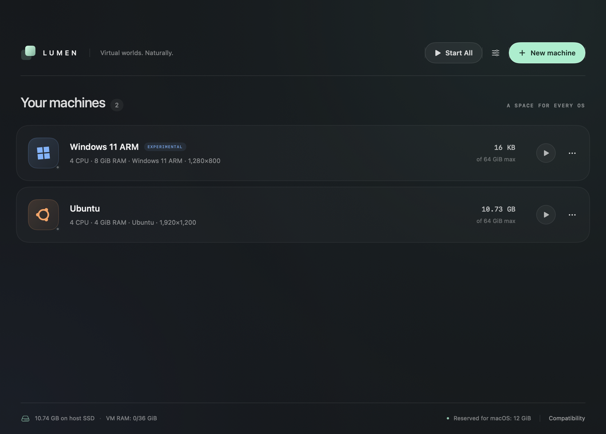

# Lumen

<p align="center">
  
</p>

<p align="center">
  
  
  
  
</p>

A native SwiftUI virtual-machine manager engineered for Apple Silicon. Features a translucent, dark glassmorphic library, native guest windows, and sparse disks that grow on-demand as guests write data. macOS and compatible ARM64 Linux guests run through Apple's Virtualization framework with hardware acceleration. Windows 11 ARM runs via an optimized QEMU backend with automated requirement bypass and resizable Cocoa display.

<p align="center">
  
</p>

See [guest compatibility and current limitations](docs/compatibility.md) for details on supported operating systems and architectures.

## Key Features

- **Touch ID Biometric VM Login**: Log into Windows and Linux VMs using your Mac's Touch ID sensor or Apple Watch. Guest passwords are encrypted in the macOS Keychain using Apple Silicon Secure Enclave hardware security. One-click unlock (or Command-L) types credentials directly into guest login screens.
- **Clean Branding & Native Dock Icons**: QEMU window titles and application menus display the actual VM name instead of 3rd-party branding. The macOS Dock displays the guest OS icon instead of a generic black terminal icon.
- **Finger-Size Screen Fix & Automated Boot**: Auto-configured EDK2 GOP resolution and automated `startup.nsh` boot sequences prevent dropping into the UEFI interactive shell and ensure windows open at full, comfortable Retina proportions.
- **Host Sleep & Wake Protection**: Monitors macOS system sleep/wake notifications to gracefully suspend guest vCPUs and hypervisor timers before sleep, then resumes them smoothly after hardware initialization, preventing hypervisor lockups and sleep crashes.
- **Lean Memory Overhead**: Configures sparse, on-demand memory allocations (`reserve=off`) and VirtIO ballooning so VMs consume minimal physical RAM until active guest processes touch memory pages.
- **Linux Distribution Catalog & ISO Detection**: Choose from tested ARM64 distributions with category filters (Popular, Server, Security, Rolling), search, and direct download links. Automatic ISO inspection reads volume labels and EFI bootloaders (`BOOTAA64.EFI`) to detect distros and immediately warn if an incompatible Intel `x86_64` ISO is selected.
- **Windows 11 ARM Requirements Bypass**: Automatic generation and mounting of `LumenSetup.iso` containing `autounattend.xml` registry bypasses (`BypassTPMCheck`, `BypassSecureBootCheck`, `BypassCPUCheck`, `BypassStorageCheck`, `BypassRAMCheck`, and `BypassNRO` for offline setup). Bypasses the installer wall without modifying host firmware. Includes CoreAudio duplex output/input and VirtIO memory ballooning.
- **Host macOS Resource Safeguards**: Automatically calculates and reserves a dedicated slice of RAM (minimum 4–16 GiB, 25% of system memory) and 1–2 CPU cores for macOS. Prevents VM overallocations from starving macOS or causing system stutter. Live RAM monitoring in the library footer tracks guest memory against the host budget.
- **Simultaneous Multi-VM Execution**: Run multiple virtual machines concurrently with one-click **Start All** and **Stop All** controls, guarded by host memory safety limits.
- **Stable Linux Disk I/O**: Configurable disk synchronization modes (`.balanced`, `.fastest`, `.full`). Uses `VZDiskImageSynchronizationMode.none` on APFS to eliminate `dpkg` `F_FULLFSYNC` barrier stalls that previously caused Ubuntu installer "Install RELEASE Is Not Responding" hangs.
- **Folder Sharing & Hardware Integration**: VirtioFS folder sharing with read/write or read-only options; one-click toolbar copy button for Linux mount commands; shared clipboard; CoreAudio duplex sound; and configurable display resolutions (1080p, 1200p, 1440p, Retina 1600p, 4K) or dynamic auto-resize.
- **Grow-Only Sparse Storage**: Disks only consume space on your SSD as the guest writes data. Safely expand disk capacity anytime in Settings without pre-allocating zeros; destructive shrinking is rejected to protect filesystems.

## Build and open

Requirements: an Apple silicon Mac, macOS 14 or later, and current Xcode Command Line Tools or Xcode with Swift and the macOS SDK. If the developer tools are missing, install them with `xcode-select --install`.

From this repository:

```sh
bash scripts/build.sh
open build/Lumen.app
```

The script builds a release app and signs it locally with the virtualization entitlement. Open the generated `.app` to run guests; a plain, unsigned `swift run` executable is not the supported launch path. You can move `build/Lumen.app` into Applications after building. This local build is not notarized for distribution.

The test suite validates configuration, sparse storage, ISO inspection, Windows unattend media, and host resource reservation:

```sh
bash scripts/check.sh
```

## Create and configure a machine

1. Open Lumen and click **+** (or press Command-N).
2. **Choose an OS or Distribution**: Select macOS, Windows 11, or explore the Linux distribution catalog. You can filter by name, review ARM64 compatibility, and open direct download pages.
3. **Select an Installer**: Select an Apple silicon **IPSW** for macOS, or an **ARM64 UEFI ISO** for Linux or Windows. Lumen automatically inspects the ISO file header, volume label, and EFI bootloader directory:
   - Recognizes Ubuntu, Debian, Fedora, Arch, Kali, openSUSE, Alpine, Windows, etc.
   - Detects ARM64 (`BOOTAA64.EFI`) compatibility and warns immediately if an Intel `x86_64` ISO (`BOOTX64.EFI`) was selected by mistake.
4. **Fine-tune Hardware & Preferences**:
   - **Hardware & Display**: Adjust CPU count and RAM within the safe macOS host reserve budget. Pick a default resolution (e.g. 1920×1200, 2560×1600 Retina) or enable dynamic auto-resizing.
   - **Sharing & Devices**: Enable folder sharing (with optional read-only mode), bidirectional clipboard, audio output, microphone, and system key capture.
   - **Storage & System**: Set disk capacity limit (sparse disk). For Linux, select disk synchronization mode (`Balanced` recommended for fast, stable package installation). For Windows, enable automated TPM/Secure Boot setup bypasses.
5. **Start and Install**: Press **Start Machine**. Windows Setup automatically loads the bypass media; Ubuntu installs without I/O stalls.
6. **Eject Installer & Mount Shared Folders**: After installation completes, choose **Eject installer** in the machine's **…** menu to boot from the installed disk on subsequent runs.

Choose **Settings…** from any stopped machine's **…** menu to adjust CPUs, memory, display resolution, audio, devices, or expand disk capacity. Disks can grow but cannot shrink.

## Host resource safeguards & simultaneous VMs

Lumen enforces host stability so macOS remains responsive regardless of guest workload:
- **Dedicated Host Reserve**: Reserves 25% of system RAM (between 4 and 16 GiB) and 1–2 CPU cores exclusively for macOS.
- **Budget Enforced**: Machines cannot be configured or started if active VMs exceed the guest memory budget.
- **Simultaneous VMs**: Click **Start All** in the library header to launch all configured virtual machines simultaneously within the host memory budget, or **Stop All** to gracefully shut them down.
- **SSD Footprint**: Sparse RAW images consume zero advance space. Physical SSD block allocation is displayed live alongside capacity limits.

## Linux integration

- **Networking**: Shares the host Mac's active internet connection via NAT virtual Ethernet.
- **Input**: USB tablet device provides smooth, absolute pointer tracking without cursor lock.
- **Display**: Configurable default resolution with optional dynamic auto-resize for supported desktop environments.
- **Disk Performance**: The balanced synchronization mode prevents extreme APFS `F_FULLFSYNC` latency during `apt` and `dpkg` operations.
- **Clipboard**: For bidirectional clipboard sharing on Ubuntu/Debian, install the guest agent:
  ```sh
  sudo apt update && sudo apt install spice-vdagent
  ```
- **Shared Folder**: To mount your shared host folder inside Linux, click the copy button next to **Shared Folder** in the guest window toolbar, or run:
  ```sh
  sudo mkdir -p /mnt/lumen && sudo mount -t virtiofs lumen /mnt/lumen
  ```

## Windows 11 ARM integration

Windows 11 runs via an optimized QEMU backend utilizing Apple's Hypervisor framework (`-accel hvf`) and EDK2 UEFI firmware:
- **Requirement Bypass**: When installing Windows 11, Lumen generates an unattended setup CD (`LumenSetup.iso`) containing `autounattend.xml` with `LabConfig` registry bypasses (`BypassTPMCheck`, `BypassSecureBootCheck`, `BypassCPUCheck`, `BypassStorageCheck`, `BypassRAMCheck`, and `BypassNRO`). The installer boots directly to setup without the "This PC can't run Windows 11" wall.
- **Scalable Display UI**: Launched with `-display cocoa,zoom-to-fit=on`, allowing you to freely resize the QEMU window and eliminate cramped, tiny text on high-DPI displays.
- **Audio & Devices**: Includes CoreAudio duplex sound (`intel-hda` / `hda-duplex`) and VirtIO memory ballooning.
- **Shared Folders & Drivers**: Windows helper media includes `Connect Mac Shared Folder.cmd` and `install-drivers.cmd`. For network connectivity, place an ARM64 VirtIO driver ISO named `Drivers.iso` in the VM's folder.

Android and ChromeOS are not implemented. The [compatibility guide](docs/compatibility.md) explains suitable images, dependencies and the work these guests still require.

## Release v27.0.0 Highlights

- **Linux Distribution Catalog**: Integrated browser with 20+ tested distributions (Ubuntu, Fedora, Debian, openSUSE, Kali, Arch Linux ARM, Alpine, Void, NixOS, etc.) with search, ARM64 tags, and direct ISO download links.
- **Smart ISO & Architecture Detection**: Automatic ISO9660 volume inspection and EFI bootloader verification (`BOOTAA64.EFI`) detects distros on selection and prevents accidental Intel x86_64 installation attempts.
- **Windows 11 ARM Requirements Bypass**: Automatic `LumenSetup.iso` generation with `autounattend.xml` registry bypasses (`BypassTPMCheck`, `BypassSecureBootCheck`, `BypassCPUCheck`, `BypassStorageCheck`, `BypassRAMCheck`, `BypassNRO`) allows Windows 11 ARM to install without hardware blocks.
- **Dynamic & Resizable Display UI**: Solved cramped, unscaled guest installer UI with QEMU Cocoa window `zoom-to-fit=on` and configurable display resolutions (up to 4K / Retina) with dynamic auto-resize for Apple Virtualization guests.
- **Ubuntu Installer Stability**: Eliminated `dpkg` `F_FULLFSYNC` APFS latency hangs ("Install RELEASE Is Not Responding") via configurable disk synchronization modes (`.balanced` / `.fastest`).
- **macOS Host Resource Reserve**: Enforces a reserved memory floor (25% / 4–16 GiB) and 1–2 CPU cores for macOS, ensuring host responsiveness even under heavy guest loads.
- **Simultaneous Multi-VM Execution**: Added "Start All" and "Stop All" actions to manage multiple VMs concurrently within the host memory safety budget.
- **Folder Sharing & Audio Duplex**: VirtioFS shared folders (read/write or read-only) with toolbar copy shortcut, CoreAudio duplex sound, and VirtIO ballooning.
- **Grow-Only Sparse Disks**: Safe disk expansion in Settings without advance space allocation or risk of filesystem corruption.

## Local diagnostics

The signed app can run a temporary live boot without installing an operating system:

```sh
open -n -W build/Lumen.app --args \
  --boot-test /absolute/path/to/ubuntu-desktop-arm64.iso \
  --boot-wait 180 --boot-memory 8 \
  --boot-snapshot /absolute/path/to/guest.png \
  --smoke-report /absolute/path/to/report.json
```

It snapshots every 30 seconds, tests pause/resume/stop, and removes its temporary disk after shutdown. The JSON report leaves guest boot verification to visual review of the screenshot. `--smoke-test` tests an empty EFI VM without an installer. Use `--demo --snapshot /absolute/path/to/library.png` for sample library artwork; these fixtures are a separate preview library and cannot start guests.
