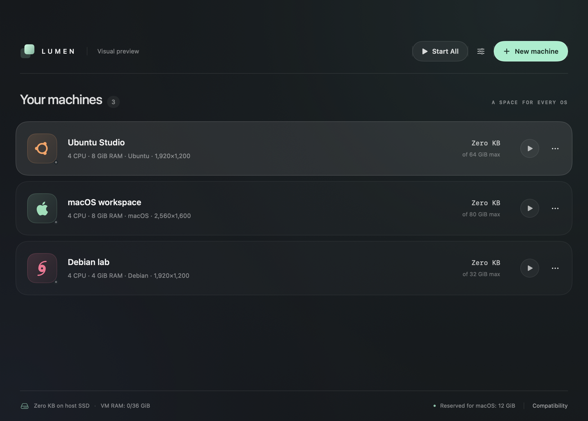

# LumensVM

**Lumen — native virtual machines for Apple Silicon.**

[](https://github.com/MrZaKaRiA/LumensVM/releases) [](https://github.com/MrZaKaRiA/LumensVM/releases/latest)

A SwiftUI app for running macOS, ARM64 Linux and experimental Windows 11 ARM64 guests. A translucent machine library, separate VM windows and disks that grow as you use them make virtual machines feel at home on your Mac.

[Release v27.2.0](https://github.com/MrZaKaRiA/LumensVM/releases/tag/v27.2.0) · [User guide](docs/user-guide.md) · [Compatibility](docs/compatibility.md) · [Changelog](CHANGELOG.md) · [MIT license](LICENSE)

<p align="center"></p>

## Features at a glance

- **Native Mac experience:** SwiftUI library, separate guest windows, OS Dock icons, full screen, keyboard capture and lifecycle controls.
- **Hardware virtualization on Apple Silicon:** Apple Virtualization for macOS/Linux; QEMU with HVF for Windows ARM64.
- **Storage that grows with use:** sparse raw disks, distinct host allocation and guest capacity counters, stopped-disk growth and cancellable reclamation with measured results.
- **Guest integration:** selected folders, Linux X11 text clipboard and terminal shortcuts, Windows ARM64 driver/repair tools and experimental Windows text clipboard.
- **Optional Linux capabilities:** Rosetta for x86-64 Linux applications and nested virtualization on supported hosts.
- **Open source:** MIT-licensed original code, with no Lumen subscription. Guest operating systems and third-party components have their own licenses.

## Guest support

Lumen runs **ARM64 guest operating systems**. It does not expose an x86/x86-64 OS emulation backend. Linux Rosetta translates supported application binaries inside an ARM64 Linux guest.

| Guest | Engine and installation media | Compatibility and validation |
| --- | --- | --- |
| macOS ARM64 | Apple Virtualization; compatible Apple Silicon IPSW, with a latest-supported-image download option | Apple's framework checks the restore image and virtual hardware model. Installation in the separate guest-process path still needs acceptance testing. |
| Ubuntu / Debian / Fedora and other ARM64 Linux | Apple Virtualization; generic AArch64 UEFI ISO | Requires suitable VirtIO kernel drivers. Ubuntu live installer boot was tested; a catalog entry does not certify every distribution or release. |
| Void / Abyss Linux ARM64 | Apple Virtualization; prepared AArch64 UEFI media | Installed Abyss/dwm tested with bidirectional text clipboard, shared Mac Desktop, runit tools and its own guest app. |
| Arch Linux ARM and board-specific distributions | Apple Virtualization; prepared AArch64 UEFI media | Rootfs archives, Raspberry Pi images and Asahi installation media are not generic VM installers. Preparation may be necessary. |
| Windows 11 ARM64 | QEMU + HVF; ARM64 ISO and ARM64 guest drivers | **Experimental.** Installed Windows demonstrated 2D Retina resizing; full automatic installation and integration still need acceptance testing. |
| Android / ChromeOS | No implemented backend | Not supported in this release. |

## Feature matrix

This describes the implementation in **v27.2.0**. Features with incomplete live coverage are labelled below; see the [validation record](docs/validation.md) for the exact tested guest, host and workflow.

| Capability | macOS guest | ARM64 Linux guest | Windows 11 ARM64 guest |
| --- | --- | --- | --- |
| Virtual graphics | Apple macOS graphics device; guest API/3D coverage unverified | Apple VirtIO graphics device; guest API/3D coverage unverified | VirtIO **2D display-only**; no Direct3D or host Metal acceleration |
| Resolution / Retina / window fit | Presets and native automatic resizing where supported | Presets and native automatic resizing where supported | Driver/service-dependent resizing; 2× Retina tested. Recovery framebuffer can remain at 800×600 |
| Guest DPI / text size | Configure in the guest | Configure in the desktop environment | Configure Windows Display Scale; 200% at 2560×1600 tested. Host stretching alone cannot sharpen text |
| Text clipboard | Not implemented | X11 via SPICE guest tools; Mac Command-C/V and terminal shortcut mode. Native Wayland clipboard unavailable | ARM64 agent and private transport bundled; bidirectional live acceptance pending |
| Multiple shared folders | VirtioFS with Apple's guest automount tag; individual read-only controls | VirtioFS, typically `/mnt/lumen`; individual read-only controls; guest mount/tools required | Private authenticated SMB2; individual read-only controls; guest tools, networking and Python runtime required |
| Send / drop files | Host → selected writable shared folder | Host → selected writable shared folder | Host → selected writable shared folder |
| Internet / network | NAT | NAT | QEMU user-mode NAT; ARM64 network driver required |
| Host port forwarding | No built-in forwarding rules | No built-in forwarding rules | TCP/UDP from Mac **127.0.0.1** to guest ports; applies on next start; guest firewall must allow traffic |
| Speaker / microphone | Independent per-VM settings | Independent per-VM settings | Independent per-VM settings; installed-guest audio acceptance pending |
| Input | Mac keyboard/trackpad and absolute-pointer devices | Virtual keyboard and absolute pointer; desktop/terminal shortcuts | USB keyboard and tablet; Windows-key / Ctrl-Alt-Delete actions and input release |
| Separate guest app / Dock entry | Implemented; installed macOS acceptance pending | Implemented; Abyss lifecycle and Dock reopening tested | Branded QEMU guest app, separate from the library |
| Pause / resume / shutdown | Implemented | Implemented | Implemented |
| Rosetta for x86-64 Linux apps | Not a Lumen option for this guest | Opt-in; host Rosetta installation and guest-tools registration required; installed-guest acceptance pending | Not a Lumen option for this guest |
| Nested virtualization | Not exposed for this guest | Opt-in, capability checked; requires macOS 15+ and supported hardware (M3 or later); guest acceptance pending | Not exposed for this guest |
| Virtual TPM / Secure Boot | Apple's macOS VM platform; no user-configurable TPM or Secure Boot controls | No configurable virtual TPM or Secure Boot option | Persistent TPM 2.0 via `swtpm`; firmware physical-presence operations disabled on this profile; current QEMU firmware profile has no Secure Boot |
| Install / eject media while running | No native media hotplug UI | No native media hotplug UI | Named installer, driver and setup-tool disc menus; read-only media, guest locks respected |

**Current limits:** one configured display and one writable boot disk per VM; no multiple-monitor UI, arbitrary USB device passthrough, printer sharing, bridged network UI, snapshots/clones, saved-memory suspend/restore, disk shrinking or Parallels/VirtualBox import. File clipboard, arbitrary guest-desktop drag-and-drop and guest-to-host drag-and-drop are not implemented. File sending above copies into an explicitly selected shared folder; it is not a desktop drag protocol.

Resolution presets include **5K**, but that is not a claim of tested 5K guest support. The Windows 3D work required is described in [graphics integration status](docs/windows-3d-integration.md); native graphics API versions and performance are not certified by the current tests.

## Storage and disk space

- **Format and allocation:** one sparse raw `Disk.img` per VM. Guest capacity is a maximum logical size, with no full-capacity preallocation. Writes, firmware, tools, logs and runtimes still consume real host storage.
- **Visible accounting:** each row shows allocated disk-image blocks on the Mac and maximum guest capacity. Allocation refreshes every **eight seconds while a VM is active**, including when its own app is frontmost. Missing/unreadable measurements show unavailable. The counter excludes other VM files and does not measure unique APFS volume usage or free space inside the guest.
- **TRIM and reclaim:** guest deletion alone may leave host allocation unchanged. Linux `fstrim` reclaimed about 128 MiB after a disposable 128 MiB write/delete test on both storage backends. **Reclaim Disk Space** scans a stopped disk, releases only verified all-zero blocks, supports cancellation and reports measured before/after allocation. It cannot identify deleted nonzero guest data. Windows/NTFS and installed macOS reclamation remain unverified.
- **Resize and durability:** disk growth requires shutdown; extend the partition/filesystem inside the guest afterwards. Balanced mode preserves guest flushes, Maximum safety requests stronger host synchronization, and Fastest relaxes synchronization with greater data-loss risk on host failure. Shrinking is unavailable.
- **Backups and portability:** shut down the VM and keep its entire `.lumen` directory, including configuration, hardware identity, EFI and Windows TPM state. Installer and shared-folder paths reference external files and may need adjustment on another Mac. Snapshots, clones and conversion/import tools are unavailable.
- **Deletion:** moving a VM to Trash keeps its storage allocated until Trash is emptied. APFS snapshots or copies can retain blocks after a file is removed or reclaimed.

See [storage accounting and reclamation](docs/storage-reclamation.md) for exact measurements, limitations and reproduction instructions.

## Installation, automation and security

- **OS setup:** macOS uses Apple's IPSW installer and can download the latest restore image supported by the host. Linux setup is interactive. Windows uses the selected local ISO, stages ARM64 drivers during Setup/first logon and offers a local-account OOBE option. A complete unattended provisioning system for every guest is not implemented.
- **Guest tools:** Linux repair supports `apt`, `dnf`, `pacman`, `xbps` and `zypper`, plus systemd and Void/runit service setup. Package availability, internet access, guest privileges and an X11 session matter. Windows provides signed ARM64 VirtIO driver media, graphics-service repair and a manual repair action; Windows still validates signatures and UAC still applies. Fresh-install display handoff needs further acceptance testing.
- **Startup and resources:** start after creation and start machines when Lumen opens are enabled by default and can be turned off. Start All respects the memory budget. CPU/RAM configuration leaves host headroom; this does not reserve dedicated physical resources or guarantee performance under load.
- **Settings and lifecycle:** CPU, RAM, graphics, folder and network configuration changes require shutdown/start. Closing a native guest window leaves the VM running; its Dock entry reopens it. Pause keeps memory in use. Sleep/wake pause/resume is best effort. A native guest survives a library crash, but reconnection to a relaunched library is not implemented.
- **Folder access:** Windows sharing uses a private loopback service exposed into that VM's network; it does not enable macOS File Sharing or publish folders on the LAN. Only selected folders are exposed. macOS permissions for protected folders such as Desktop still apply. Native guests use VirtioFS.
- **Login helpers:** optional Keychain/Touch ID storage requires user presence for newly saved passwords. The typing helper needs a focused guest field, printable ASCII and a US guest keyboard layout; it does not detect login screens. Ad-hoc rebuilds can change Keychain prompts.
- **Scope and licensing:** local builds are ad-hoc signed, with pinned downloaded build resources; standalone runtime packaging, Developer ID signing and notarization remain pending. Lumen's MIT license does not include guest OS licenses or waive third-party redistribution obligations.

## Get v27.2.0

v27.2.0 is a **source release**. Download the [release](https://github.com/MrZaKaRiA/LumensVM/releases/tag/v27.2.0), or clone the repository, then build on an Apple Silicon Mac. A notarized standalone installer is not included.

### Requirements

- Apple Silicon Mac with macOS 14 or later; Intel Macs are not a supported host target.
- Current Xcode or Command Line Tools with Swift 5.9 or newer and a macOS SDK supporting the APIs used by your host.
- [Homebrew](https://brew.sh/) for build/runtime dependencies.
- Your own compatible ARM64 ISO or Apple Silicon IPSW. OS images and licenses are not included.
- The wizard's per-VM minimums are 4 GiB RAM / 64 GiB guest disk capacity for macOS and Windows, and 2 GiB / 16 GiB for Linux. The selected OS/desktop may need more. Disk capacity is a logical limit, not upfront SSD allocation.

```sh
git clone https://github.com/MrZaKaRiA/LumensVM.git
cd LumensVM
git checkout v27.2.0
brew install qemu swtpm python@3.14 sevenzip
bash scripts/build.sh
open build/Lumen.app
```

The build prepares pinned third-party driver and guest-tool resources over HTTPS and signs the app locally with virtualization entitlements. The result is **ad-hoc signed, not Developer ID signed or notarized**. Windows requires Homebrew QEMU and ARM64 firmware; TPM support uses `swtpm`, and private Windows folder sharing uses Python 3.14. These runtimes consume additional space and are not bundled as a standalone Windows engine. See [third-party notices](THIRD_PARTY_NOTICES.md).

## First VM

1. Choose **New machine** or press Command-N. Select an OS and a compatible installer, or drop an ISO/IPSW onto the library.
2. Set CPU, RAM and maximum disk capacity. Add only the Mac folders you want the guest to access.
3. Create the machine and complete its OS installer. Guest disks live in `~/Library/Application Support/Lumen/Machines/`.
4. For Linux clipboard and folder integration, open a guest terminal and choose **Install / Repair Linux Guest Tools… → Type in Guest Terminal**. Authenticate inside Linux when sudo asks.
5. For Windows, use the automatic setup tools or **Devices → Install / Repair Windows Drivers…**, approve UAC and restart if requested. See the [Windows driver and Retina guide](docs/user-guide.md#windows-arm64-drivers-and-retina).

For sharp text, the guest must render enough pixels and use suitable guest DPI scaling. Enlarging a low-resolution framebuffer cannot add detail. With Linux terminals, use **Edit → Use Terminal Copy/Paste Shortcuts**; Abyss enables this by default.

Closing a native VM window leaves it running. Click its separate OS Dock icon to reopen it. Shut down the guest before changing hardware or deleting its disk. Deleting files inside a guest may need TRIM/compaction before macOS reclaims space; moving a VM to Trash retains its storage until Trash is emptied.

## Development and validation

```sh
bash scripts/check.sh
PYTHONPATH=.runtime/WindowsSharing /opt/homebrew/opt/python@3.14/bin/python3.14 -B scripts/sharing/test-server.py
codesign --verify --deep --strict build/Lumen.app
bash scripts/release-audit.sh
```

The latest local validation passed 48 core tests and the display-redraw regression, plus disposable Linux/ext4 write/delete/TRIM checks on both storage backends and live reclaim-menu checks. Earlier releases also passed live Abyss lifecycle/Dock checks. The security, performance, Rosetta/nested-virtualization and restore-image changes from v27.1.0 have not received full installed-guest acceptance. Windows private-sharing transport has separate tests. These checks do not certify every guest or a production-ready Windows installation. The release audit deliberately reports missing notarization and standalone runtime packaging. Detailed results are in [validation](docs/validation.md).

## Documentation and contributing

- [User guide](docs/user-guide.md): settings, clipboard, sharing, drivers, storage and diagnostics.
- [Compatibility](docs/compatibility.md): supported paths and practical limitations.
- [Feature audit](docs/feature-audit.md) and [Windows 3D status](docs/windows-3d-integration.md): remaining engineering work.
- [Contributing](CONTRIBUTING.md), [security reporting](SECURITY.md) and [release process](docs/releasing.md).

Report reproducible bugs through [GitHub Issues](https://github.com/MrZaKaRiA/LumensVM/issues). Include host/guest versions and the relevant redacted logs; never upload VM disks, guest passwords or private shared-folder contents.

## License

Lumen's original code is [MIT licensed](LICENSE). Third-party components and guest OS trademarks retain their own licenses and ownership; see [THIRD_PARTY_NOTICES.md](THIRD_PARTY_NOTICES.md).
